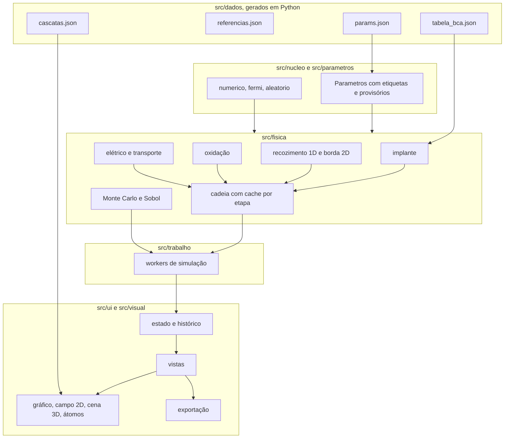

# Arquitetura do gfetsim estúdio

## Camadas

## Fluxo de uma simulação

1. Um campo da receita muda e o estado guarda a receita nova no histórico de desfazer.
2. Depois de 380 ms sem outra mudança, o cliente manda a receita para dois workers. O rápido calcula a cadeia sem a borda 2D e responde em cerca de 2 s; o completo calcula também a borda 2D e responde em cerca de 4 s.
3. Um pedido novo encerra o worker ocupado e cria outro, então a resposta que chega é sempre a da receita mais recente.
4. Dentro do worker, a cadeia guarda cada etapa num cache indexado pela parte da receita de que ela depende. Mudar a mobilidade do grafeno não refaz o recozimento, e mudar a temperatura do forno não refaz o implante.
5. O resultado volta por mensagem e as vistas inscritas no estado se redesenham.

## Workers

Os workers são clássicos e embutidos no HTML como blob. Módulos em blob falham em origens opacas, que é o caso de um arquivo aberto do disco e de molduras isoladas. Se o navegador recusar o worker antes da primeira mensagem, o cliente passa para a thread principal e reenvia o pedido.

O Monte Carlo usa um conjunto próprio de workers, um a menos que os núcleos da máquina e no máximo seis. As amostras vão em fatias de quatro, para os histogramas encherem enquanto a rodada anda.

## Desenho

Gráficos, corte 2D, transistor e bandas desenham por uma interface comum, o Pincel, com duas implementações. A de canvas desenha na tela e no PNG de alta resolução; a de SVG gera a figura vetorial. Assim a figura exportada é a mesma que aparece na tela.

O corte 2D colore a grade da simulação numa imagem do tamanho da grade e a amplia com interpolação. Na oxidação, cada coluna é deslocada pelo Si consumido, para tudo aparecer no referencial da superfície original. As isolinhas saem por marching squares no logaritmo da concentração.

As cenas 3D usam Three.js carregado sob demanda. A geometria é de prismas extrudados com espessura unitária e escala vertical, o que deixa mudar o exagero sem refazer a malha. O corte A−A′ é um plano de recorte, e as faces cortadas recebem tampas desenhadas à parte, porque o recorte do Three.js deixa os sólidos ocos.

## Regras do gfetsim mantidas no porte

| Regra | Como aparece no estúdio |
|---|---|
| valor null bloqueia o modelo | `Parametros.valor` lança `ParametroAusente`; desligar os provisórios na receita faz a cadeia parar e o console dizer qual chave falta |
| provisório aceito vira [I] e fica registrado | a lista aparece no inspetor, no relatório e na aba Parâmetros |
| valor do usuário vira [B] | a sobrescrita na aba Parâmetros entra na receita e muda a etiqueta |
| ramos nunca se misturam | cada ramo é um campo da receita; o Monte Carlo usa uma combinação por rodada e diz qual |
| incerteza declarada é a amostrada | o Monte Carlo lê o tipo e a faixa de cada parâmetro no params.yaml |
