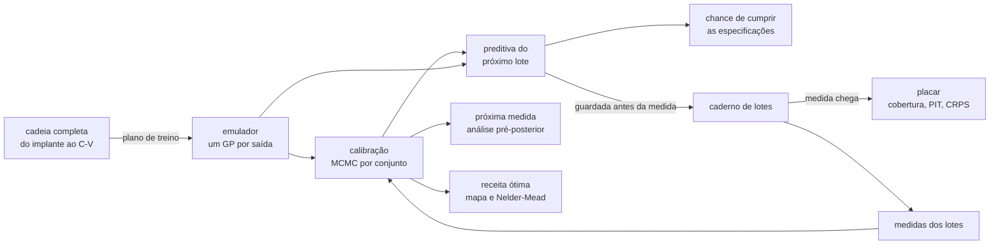

# Previsão do próximo lote

A vista Previsão transforma a cadeia física num instrumento de previsão. Ela responde
três perguntas que a simulação nominal não responde. O que o próximo lote vai dar, com
que incerteza. Qual medida fazer a seguir para prever melhor. Qual receita tem mais
chance de cumprir a especificação. E guarda as previsões feitas antes da medida, para
mostrar depois se elas acertaram.

## Fluxo

## Espaço

O emulador vive no cubo unitário [0, 1]^d formado por dois tipos de entrada.

| Tipo | Exemplos | O que acontece com ele |
|---|---|---|
| variável de receita | T e tempo da oxidação, T do RTA, dose | o usuário escolhe; na previsão recebe a dispersão do equipamento do params.yaml |
| parâmetro de calibração | fator da taxa de oxidação, fator da mobilidade no Si, fator de n_e, carga fixa, dopagem residual, mobilidade do grafeno, n* | ninguém controla; a priori vem do params.yaml e as medidas a estreitam |

Faixas log-uniformes são lineares no logaritmo, então a priori fica plana no cubo. Para
a priori normal o domínio é a média ± 3σ, com densidade normal truncada. Dois fatores
novos entraram no params.yaml, ambos [I] com a justificativa da faixa ao lado:
`previsao.fator_taxa_oxidacao` (0,8 a 1,25, cerca de 10 °C de erro de forno) e
`previsao.fator_mobilidade_si` (0,7 a 1,3, entre R52 e R24).

## Emulador

Um processo gaussiano por saída (Rasmussen e Williams, 2006), com núcleo exponencial
quadrático, um comprimento por dimensão, média constante pela padronização e ruído
branco pequeno. O ruído absorve as descontinuidades da cadeia, como a SPE que completa ou
não e os passos de 0,5 nm da oxidação. Resistências e concentrações são emuladas no
logaritmo natural.

Os hiperparâmetros maximizam a verossimilhança marginal com uma priori fraca nos
logaritmos (log ℓ ~ N(log 0,5; 1,5²)), por Adam com o gradiente analítico e dois
reinícios. O plano de treino é um hipercubo latino escolhido entre doze pela máxima
distância mínima, mais o centro.

O erro de cada saída é o RMSE da validação cruzada deixando um de fora, calculado em
forma fechada (eq. 5.12 do livro). Esse número entra como desvio constante do emulador na
verossimilhança e na preditiva. A escolha é conservadora perto dos pontos de treino e
torna a média barata, O(n d) por avaliação, o que deixa a calibração rodar em cerca de
um segundo.

## Calibração

Para uma medida d de uma saída s num lote de receita x, na escala transformada,

d ~ N(η_s(x, θ), σ_med² + σ_emu² + σ_disc² + σ_disp²)

com η a média do emulador. σ_disc é a discrepância de modelo de `previsao.discrepancia`,
a forma de Kennedy e O'Hagan (2001) sem correlação entre lotes. σ_disp é a dispersão do
equipamento propagada pelo gradiente do emulador no centro da priori. Medidas diretas de
um parâmetro, como a dopagem pelo Raman, entram com verossimilhança normal nele.

A posteriori é amostrada pelo amostrador por conjunto invariante a transformações afins
(Goodman e Weare, 2010), com max(4d, 32) caminhantes e 3000 passos por padrão. Os
diagnósticos são a aceitação, o tempo de autocorrelação integrado com a janela de Sokal,
o tamanho efetivo e o R̂ dividido de Gelman e Rubin. A vista avisa quando o R̂ passa de
1,1, quando o tamanho efetivo fica abaixo de 200 e quando os resíduos padronizados têm
média quadrática acima de 3. Esse último caso quer dizer que o modelo não explica as
medidas.

## Preditiva e especificações

Cada sorteio pega um θ da posteriori, aplica a dispersão do equipamento à receita,
avalia o emulador e soma o erro dele e a discrepância. A chance de cumprir conta os
sorteios que satisfazem todas as especificações ao mesmo tempo, o que respeita a
correlação entre saídas que vem de θ. A tabela separa a parte da variância que vem de θ,
a única que medidas reduzem, do piso irredutível.

## Próxima medida

Análise pré-posterior (Chaloner e Verdinelli, 1995). Para cada medida candidata,
sorteia 48 resultados possíveis pela preditiva atual. Com cada resultado repesa por
importância 800 amostras da posteriori. A redução esperada do desvio da saída-alvo na
receita-alvo ordena as candidatas. O tamanho efetivo médio da repesagem aparece ao
lado, porque abaixo de 30 o número é aproximado.

## Receita ótima

A chance de cada receita é a média, sobre 160 sorteios fixos de θ e da dispersão, de
Π_s [Φ((hi − η)/σ) − Φ((lo − η)/σ)], com σ o ruído irredutível de cada saída. Os sorteios
fixos deixam a função lisa entre receitas vizinhas. O mapa avalia 30 × 30 receitas nas
duas variáveis escolhidas. O ótimo sai de uma busca grossa seguida de Nelder-Mead no cubo
das variáveis livres. A chance final é reavaliada com outros 400 sorteios, para não
carregar o viés da busca. A vista avisa quando o ótimo encosta na borda da faixa de
treino.

## Placar

Só contam previsões guardadas no lote antes da medida. Para cada par há três medidas.
A cobertura dos intervalos de 68 e 95 % vem com o intervalo de Wilson. O PIT (Dawid,
1984) deve ser uniforme. O CRPS amostral (Gneiting e Raftery, 2007) é calculado na
escala transformada.

## Validação

| Teste | O que confere | Resultado |
|---|---|---|
| álgebra | Cholesky e inversa contra a identidade; Φ e Φ⁻¹ | erro < 10⁻¹⁰ |
| gradiente da verossimilhança | analítico contra diferença central | erro relativo < 10⁻⁵ |
| GP em função lisa | sin(3x₀) + x₁² com 40 pontos | RMSE < 0,03, Q² > 0,99 |
| validação cruzada | forma fechada contra reajuste sem o ponto | igual em 6 casas |
| MCMC | normal correlacionada com ρ = 0,8 | média, variância e ρ dentro do erro de Monte Carlo, R̂ < 1,05 |
| autocorrelação | AR(1) com φ = 0,8, τ = 9 | dentro de 20 % |
| calibração | θ verdadeiro recuperado com emulador de brinquedo | mediana em 2 % do fator, encolhimento > 90 % |
| preditiva | intervalo de 95 % cobre o valor verdadeiro e é mais estreito que o da priori | passa |
| planejamento | medir o alvo reduz mais de 60 %; medir uma saída que não depende do θ do alvo, menos de 10 % | passa |
| otimização | acha a temperatura que acerta a espessura | erro < 8 °C |
| cadeia completa | emulador com 14 simulações reproduz a espessura fora do treino | erro < 0,35 nm, Q² > 0,97 |
| calibração na cadeia | lote sintético da própria cadeia, fator da taxa | intervalo de 95 % cobre o verdadeiro |
| caderno | CRPS, Wilson, cobertura e PIT, CSV de ida e volta | passa |

## O que a previsão não captura

1. O θ é o mesmo em todos os lotes. A dopagem residual e a mobilidade do grafeno mudam
   de dispositivo para dispositivo, e aqui a variação entre eles cai na discrepância. Um
   modelo hierárquico, com média e espalhamento populacional, é a extensão natural.
2. A discrepância de modelo não tem correlação entre lotes nem entre saídas. Se o
   modelo erra a espessura sempre para o mesmo lado, a calibração empurra os fatores para
   compensar, e a previsão fica boa só perto das receitas medidas.
3. O erro do emulador é um desvio constante por saída. Longe dos pontos de treino o
   erro real pode ser maior, e a vista só avisa quando a receita sai da faixa.
4. A dispersão do equipamento só existe onde o params.yaml a declara (dose, energia,
   inclinação, T do RTA e T da SPE). Temperatura e tempo da oxidação entram sem
   dispersão até alguém medir a do forno.
5. Os ramos discretos da receita (aceleração da oxidação, desativação, barreira do
   tunelamento) ficam fixos no emulador. Comparar ramos pede um emulador por ramo, e a
   evidência entre eles não é calculada.
6. A verdade dos lotes sintéticos sai da própria cadeia. Eles testam o fluxo e o
   código, não a física.
